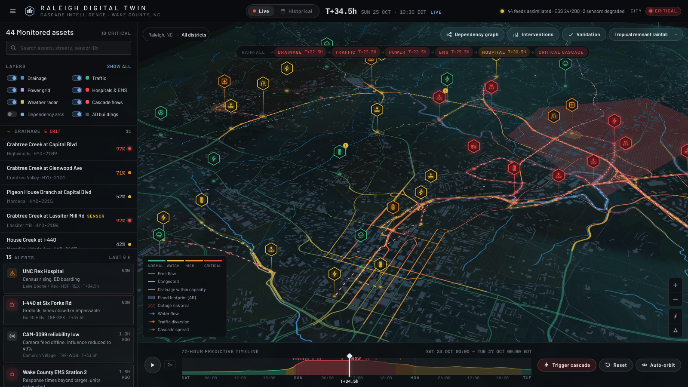
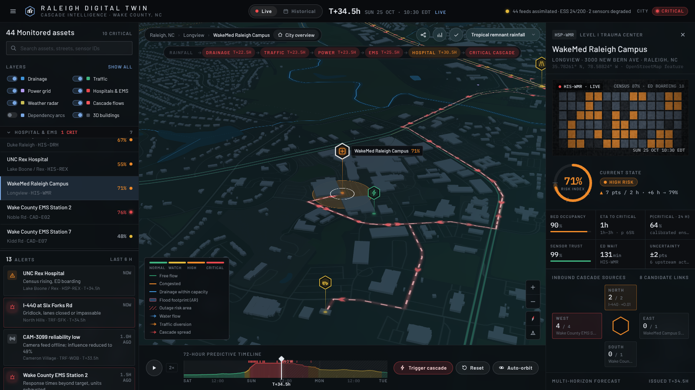
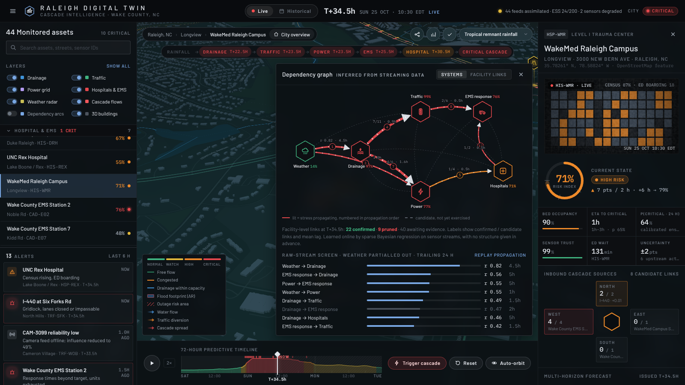

# Raleigh Digital Twin · Cascade Intelligence

An urban digital twin of Raleigh, North Carolina, with a crisis-cascade layer that predicts how a
storm propagates through drainage, roads, power, emergency response and hospitals up to 72 hours
ahead. The city model is real: OpenStreetMap buildings, streets, creeks and facilities rendered
in 3D. The cascade intelligence is one analytical layer on top of it, the way production CIM and
digital-twin platforms are structured.



| Facility inspector | Inferred dependency graph |
| --- | --- |
|  |  |

## Run it

```bash
python3 -m http.server 8000      # from the repository root
# open http://localhost:8000
```

Any static file server works. Opening `index.html` straight from disk (`file://`) also works, but
browsers block local `fetch` there, so the map falls back to live OpenFreeMap tiles.

**Everything you see is a simulation.** The city (facilities, streets, creeks, buildings) is real
OpenStreetMap data; the hazard, every sensor reading, citizen report and outcome are generated by a
modeled scenario. The interface says so: a **Simulation** badge, a **Now / Replay** time mode
instead of "live", the clock marked as scenario time, scenarios tagged *modeled*, and the
inspector's feed and physical readings (stage, occupancy, speed…) marked as illustrative, since they
are derived from the risk index rather than measured.

### Pages and links

The app is a set of pages in one document, addressed by the URL hash, so the engine and the 3D city
are built once and every view can be linked to. Today there is one page, the digital twin at
`#/twin`; the website plan adds the others on the same model. The shared context travels in the
query (`src/js/site/store.js`):

| Parameter | Meaning | Example |
| --- | --- | --- |
| `s` | scenario (`tropical`, `flash`, `heat`) | `s=flash` |
| `t` | view time in hours from T+0; absent = follow the simulated now | `t=40` |
| `m` | `replay` for replay mode; absent = now | `m=replay` |
| `a` | selected facility id | `a=HSP-WMR` |

For example `http://localhost:8000/#/twin?s=flash&t=40&a=HSP-WMR` opens the flash-flood scenario at
T+40 with WakeMed selected. Selecting a facility, switching mode or scenario adds a history entry
(back/forward replay them); scrubbing time updates the current one. Unknown scenarios or facilities
are dropped from the link, and unknown pages fall back to the twin with a note.

`python3 tools/build_dist.py` produces `dist/index.html`, a single page with all CSS and JavaScript
inlined, plus `dist/data/bundles/`: the tiles and glyphs packed as base64 JSON for hosts that only
serve text and web media types, and `dist/data/models/`: the hero models as base64 JSON with their
texture images. It runs under a strict Content-Security-Policy (`connect-src 'self'`, scripts only
from cdnjs and cdn.jsdelivr.net) and is what the published artifact is built from.

### Renderer: Mapbox GL JS or MapLibre GL JS

The map code is written against the Mapbox GL JS API (`Map`, `Marker`, `fill-extrusion`, `flyTo`,
`addSource`/`addLayer`, canvas sources, custom layers).

- **MapLibre GL JS 4.7 (default):** the open-source continuation of Mapbox GL JS with the same
  API. It renders the OpenStreetMap vector tiles shipped in `data/tiles` through a `twin://`
  protocol, so the twin works offline and inside sandboxed frames that block third-party requests.
  This is the path the realism work below was built and tested on.
- **Mapbox GL JS v3:** set `mapboxToken` in `config.js` to a Mapbox public token. The twin then
  loads the Mapbox Standard style with Mapbox's own 3D buildings, landmarks and trees, pulls its
  palette toward the dark command-center look (`setConfigProperty` on the `basemap` import) and
  switches its light preset (dawn, day, dusk, night) as the timeline is scrubbed. The hero models
  go into Standard's `middle` slot and the dependency arcs and radar into `top`. If the token is
  rejected or the style does not load within 15 s, the failed map is removed and the app falls
  back to MapLibre.
  **Untested:** no valid token was available while this was built. Only the fallback has run (an
  invalid token gets a 401 on the style and the app comes up on MapLibre); Standard itself, the
  `setConfigProperty` keys, the light preset switching and the slot placement have not.
  **Known limitation:** Standard's buildings come from Mapbox's own tiles and cannot be clipped,
  so at a hero site the Mapbox building and the hero model overlap. The OSM footprint swap
  described below only works on MapLibre.

## Realism pipeline (MapLibre)

The city is drawn in three layers that share one sun, computed from the simulation clock
(`core.sunPosition`, NOAA low-precision ephemeris; T+0 is Sat 24 Oct 2026 00:00 EDT, live is T+34.5).
Scrubbing the timeline moves the sun, the sky, the haze and every shadow.

1. **City buildings** (`src/js/map/buildings.js`): a WebGL2 custom layer that decodes the building
   layer of every z13+ tile MapLibre loads and meshes it: walls and flat roofs from the footprint
   (earcut), gable roofs fitted to the oriented bounding box of small houses. A procedural shader
   draws facades in world metres per building class (punched windows, ribbon glazing, curtain
   walls, storefronts, ribbed industrial cladding), roofing (shingle courses, membrane, rooftop
   plant), sky reflections and sun glints in glass, and lit windows at night that fade to a dim
   average once they are smaller than a couple of pixels. Each wall carries its direction in its
   vertex data, so the window grid stays exact up close. A sun shadow map (4096², 2048² on
   software rasterisers) is re-rendered only when the sun, the shadow region or the drawn tiles
   change, and shades the buildings and a ground quad. Without WebGL2 or local tiles, or if the
   driver rejects its shaders, it steps aside and the style's fill-extrusions show.
2. **Hero models** (`src/js/map/heroes.js`): a Three.js layer (three@0.160.0, imported from
   cdn.jsdelivr.net on first use) that shows a detailed glTF model of the selected facility, with a
   ground ring and halo in its risk colour, sun-matched lighting and its own shadows. The OSM
   footprints under each hero site are lifted out of the tiles (`geodata.sites`) and hidden while
   the model stands there, in both the city-building layer and the fill-extrusion fallback. Models
   exist for hospitals, EMS stations, the pumping station, substations, traffic sites and the
   weather station (on its roof at 13.5 m); stream and culvert gauges keep their marker only.
3. **Basemap and sky** (`src/js/map/style.js`): the dark CIM palette, a sky and horizon haze per
   day phase, and the MapLibre light following the sun.

Configuration (`config.js`): `cityBuildings: false` keeps the fill-extrusions, `buildingShadows:
false` drops the shadow map, `shadowSize` overrides its size.

Frame times downtown (1600×900, zoom 16.4, pitch 60, about 250k triangles; `node tools/test/perf.js
<url> [gpu]`; medians over several runs on a laptop, so the ranges are mostly machine load):

| | City buildings + shadows | City buildings, no shadows | Fill-extrusion fallback |
| --- | --- | --- | --- |
| Intel integrated GPU (D3D11) | 25–55 ms | 25–45 ms | 16–36 ms |
| SwiftShader (headless, software) | 0.84–1.15 s | 0.82–1.0 s | 0.49–0.81 s |

On a GPU the shadow pass costs little: it runs once per camera move or sun step (0 times across
static frames, `stats.shadowPasses`), not every frame.

### Provenance and honesty notes

- **Building classes and heights are estimates.** `tools/enrich_buildings.py` classifies each
  building by the OSM land-use polygon its centroid falls in and, where OSM has no height tag (most
  of Raleigh), infers one from footprint area and class (`inferred = 1` in the tiles). Explicit OSM
  heights are kept. Facade style, window rhythm and roof shape follow from those estimates, not
  from surveys or imagery.
- **The hero models are authored, not downloaded.** No realistic, CC0-licensed models of these
  facilities (or of generic ones at the needed detail) could be downloaded, so they were built at
  real scale in code (`tools/models/facility_models.js`). They are representative of each facility
  type, not replicas of the real buildings. Two sites overlap a neighbouring OSM building that was
  not lifted out of the tiles: the north edge of the Duke Raleigh Hospital model and one corner of
  the Lake Boone pumping station yard.
- **Textures:** Poly Haven PBR sets (CC0): asphalt_02, bitumen, brick_wall_10, concrete_floor_02,
  concrete_pavement, concrete_slab_wall, concrete_wall_008, corrugated_iron, factory_brick, gravel,
  leafy_grass, painted_metal_shutter, red_brick_03, sparse_grass, white_plaster_02. The `gen_*.png`
  decals (helipad, emergency and EMS signs, chain-link) are drawn by the build page.

### Rebuilding the models

```bash
node tools/models/export_models.js preview/   # needs Playwright + Chromium and cdn.jsdelivr.net
```

It opens `tools/models/build.html` in headless Chromium, builds each model with three.js, writes
`data/models/*.glb` (and optional preview renders), then `externalize.py` points the glTF images at
the shared files in `data/models/textures/`. `tools/build_dist.py` wraps them as base64 JSON for
single-page builds (`modelBundles`).

## What is real and what is modeled

| Real (OpenStreetMap, ODbL) | Modeled for the simulation |
| --- | --- |
| Buildings with heights, streets, creeks, ponds, parks: 170 vector tiles, z10–14 | Storm scenarios and the hidden "ground truth" run |
| Hospitals (WakeMed Raleigh, 628 beds; Duke Raleigh, 186; WakeMed North, 61; UNC Rex) | Risk indices, capacities, sensor IDs and readings |
| 31 Duke Energy substations with OSM voltages; their Voronoi service areas | Dependency weights in the ground-truth run |
| Wake County EMS stations, the Lake Boone pumping station | Injected sensor faults and false citizen reports |
| Gauges at exact creek × road crossings (e.g. Crabtree Creek at Glenwood Ave) | UNC Rex bed count (not tagged in OSM) |
| Every dependency route: Dijkstra on the real street graph or down the real waterway graph | Rain gauge sites |

## How the intelligence layer meets the brief

| Requirement | Implementation |
| --- | --- |
| **Multi-horizon forecasting** | 200-member ensemble. Each facility gets P(critical) and a fan chart at +1/6/12/24/48 h, plus time-to-critical with p10–p90. Forecasts are perturbation forecasts anchored to the current analysis. |
| **Dependency discovery** | No structure is given. 71 candidate links (7 deliberately spurious) are learned online by sparse Bayesian regression (ARD) on the sensor streams, then confirmed, pruned or left as awaiting evidence. By T+72 h on the tropical storm: 32 confirmed, 12 pruned. A separate raw-stream screen (lagged correlation, weather partialled out by distributed-lag regression) checks the structure at system level. |
| **Cascade prediction** | Lagged propagation with feedback loops: hospital → EMS → hospital, diversion between hospitals, load transfer between substations. The timeline, cascade strip and graph show the stage-by-stage sequence, observed and forecast, numbered in propagation order. |
| **Online learning under drift** | A localized particle filter with forgetting (about a 23 h memory) and adaptive tempering keeps the effective sample size at or above 12%. Recursive estimators update every 30 minutes without retraining. "Trigger cascade" replays the streams from T+0 so you can watch this happen. |
| **Uncertainty and adversity** | Sensor trust comes from spread-normalized residuals and flatline detection. Suspect channels are quarantined, meaning their past evidence is forgotten quickly. In the tropical run the frozen gauge, offline camera and biased rain gauge are flagged with no false flags. Planted false citizen reports score 12–16% corroboration; genuine ones score 84–96%. |
| **Causal explainability** | Every risk value decomposes into baseline, hazard and each upstream link (posterior weight ± sd, lag, mechanism, upstream sensor reading and trust). The strongest chain back to the hazard is shown, e.g. Rainfall → Pigeon House Branch → Capital Blvd → EMS Station 2 → WakeMed. |
| **Constrained counterfactuals** | 7 actions with crew costs and side effects (an evacuation loads I-440; a detour loads Wake Forest Rd). They are re-simulated from the decision time on the most probable members, and a greedy planner chooses within the budget. At T+34.5 h with 5 crews it picks pumps, EMS staging and an early Capital Blvd closure: −13% critical facility-hours, −30% hospital/EMS critical hours. |
| **Generalization** | Three scenarios with different hazards and cascade shapes run through the same engine without retuning: tropical rainfall, a convective flash flood, and a heat wave with a derecho. The learned structure changes with them. |
| **Temporal validation** | Historical mode replays the window. Every forecast uses only data up to its time stamp and is scored against the hidden truth. |

Replay validation (24 h warning rule: P(critical within 24 h) ≥ 60%):

| Scenario | Brier | Skill vs climatology | Detection | False alarms | Median lead |
| --- | --- | --- | --- | --- | --- |
| Tropical remnant rainfall | 0.076 | +0.59 | 82% | 25% | 19.0 h |
| Convective flash flood | 0.070 | +0.63 | 77% | 5% | 16.5 h |
| Heat wave and grid stress | 0.019 | +0.81 | 77% | 0% | 23.0 h |

These numbers come from a synthetic ground truth generated by the same family of models. They
show that the pipeline works end to end and is honestly isolated from future data. They are not
evidence of real-world skill.

## Layout

```
index.html, config.js      page shell and runtime configuration
src/css/                   tokens, layout, panels, map chrome
src/js/core.js             risk vocabulary, seeded RNG, geo helpers
src/js/engine/             scenarios, ensemble + assimilation + learning, interventions
src/js/map/                basemap style, layers, hex markers, radar, renderer bootstrap
src/js/ui/                 sidebar, inspector, timeline, drawers, sensor feed, app orchestrator
src/js/site/               shared context in the URL (store.js) and the page router (router.js)
src/js/views/              pages; twin.js mounts the operations room at #/twin
src/js/data/geodata.js     generated: facilities, routes, networks (from OSM)
data/tiles, data/fonts     baked OpenMapTiles vector tiles and label glyphs
tools/                     data pipeline (MVT decoder, spec, builders) and tests
```

### Data pipeline

```bash
python3 tools/fetch_tiles.py data/tiles   # OpenFreeMap tiles for the extent (already committed)
python3 tools/build_data.py               # decode tiles → src/js/data/geodata.js
```

`tools/spec.py` is the authored knowledge base: which facilities are monitored and which links
engineers consider possible. `tools/mvt.py` is a dependency-free vector-tile decoder.
`build_data.py` places gauges at exact creek × road crossings, routes links on the street and
waterway graphs, chunks the corridor and drainage networks, and computes the substation service
areas.

### Tests

```bash
node tools/test/engine_probe.js tropical          # engine timeline, learning, validation
node tools/test/interventions_probe.js            # counterfactual planner
node tools/test/smoke.js http://localhost:8000/ out/   # headless browser run (Playwright)
node tools/test/routes.js http://localhost:8000/       # deep links, back/forward, simulation labels
node tools/test/heroes.js http://localhost:8000/ out/  # each hero model, plus dawn/noon/dusk/night
node tools/test/shot.js http://localhost:8000/ out/ '[{"time":37},{"shot":"noon"}]'  # scripted views
node tools/test/perf.js http://localhost:8000/ gpu     # frame times downtown
python3 tools/test/csp_server.py 8766             # serve dist/ under a strict CSP
```

The browser tests launch Chromium on SwiftShader (software GL), where a frame of the city takes
close to a second; `interactions.js` can time out on its phone step there, with or without the
city-building renderer. On a machine with a GPU, drop the SwiftShader flags. On Windows,
`python -m http.server` occasionally refuses one of the page's parallel script requests (its
listen backlog is 5), which leaves the page on its loading screen; reload or use another server.

## Attribution

Map data © OpenStreetMap contributors (ODbL) · tiles © OpenMapTiles, served by OpenFreeMap ·
rendering by MapLibre GL JS (BSD-3) and three.js (MIT) · earcut (ISC) · textures by Poly Haven (CC0).
